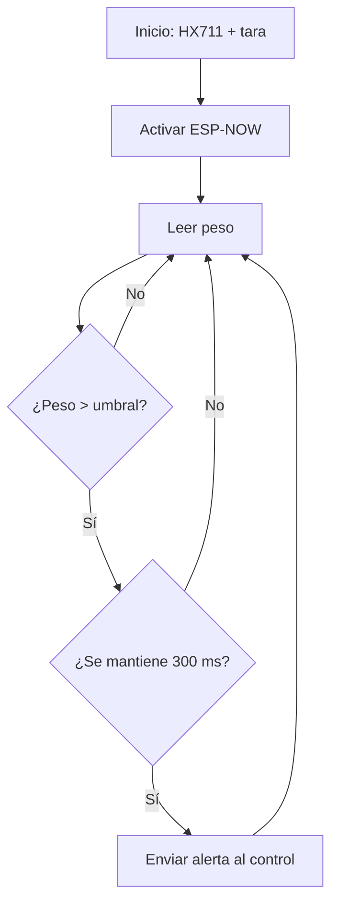
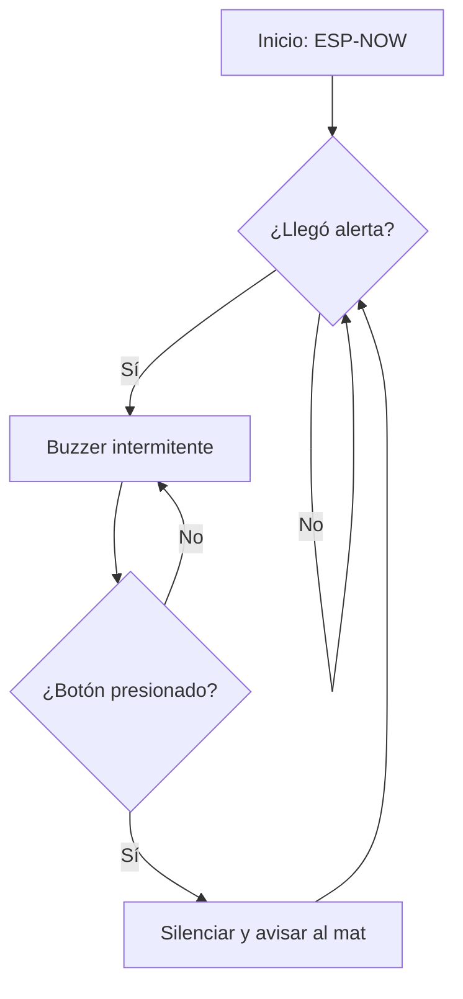

# Documentación de Software

## Contenido

### Diagramas de Flujo

**Mat (detección y envío de alerta):**

**Control (alarma y botón):**

### Documentación de Funciones

#### Funciones Principales (mat)

**enviarAlerta()**
- **Propósito:** enviar la alerta al control por ESP-NOW (3 veces, para asegurar que llegue).
- **Parámetros:** ninguno.
- **Retorna:** nada.

**esperarHX711()**
- **Propósito:** esperar a que el amplificador HX711 responda antes de continuar. Evita reinicios por un mal contacto.
- **Parámetros:** ninguno.
- **Retorna:** nada (muestra un aviso por el monitor serial si no responde).

**alRecibir(mac, datos, largo)**
- **Propósito:** se ejecuta al recibir un mensaje del control. Si es tipo 2, indica que el cuidador atendió la alarma.
- **Parámetros:** `uint8_t *mac` (origen), `uint8_t *datos` (mensaje), `uint8_t largo`.
- **Retorna:** nada.

**alEnviar(mac, estado)**
- **Propósito:** informa si el mensaje llegó al control (`Entrega OK` o `Entrega FALLO`).
- **Parámetros:** `uint8_t *mac`, `uint8_t estado`.
- **Retorna:** nada.

#### Funciones Principales (control)

**alRecibir(mac, datos, largo)**
- **Propósito:** al recibir un mensaje tipo 1 (alerta), activa la alarma.
- **Parámetros:** `uint8_t *mac`, `uint8_t *datos`, `uint8_t largo`.
- **Retorna:** nada.

---

## Manual de Instalación

1. Instalar el Arduino IDE 2.x.
2. Instalar el core ESP8266 (v3.1.2) y la librería HX711 (v0.7.5). Ver `software/librerias/README.md`.
3. Cargar `src/mac/mac.ino` en cada placa y anotar su dirección MAC.
4. Escribir la MAC del control en `macControl` (`src/mat/mat.ino`) y la del mat en `macMat` (`src/control/control.ino`).
5. Calibrar el mat con `src/calibracion/calibracion.ino` (ver "Calibración del Mat" en `software/README.md`) y escribir el resultado en `FACTOR_ESCALA`.
6. Cargar `src/mat/mat.ino` en el Wemos D1 (mat) y `src/control/control.ino` en el Wemos D1 Mini (control).

---

## Manual de Operación

### Encendido del Sistema
1. Con el mat vacío y quieto, conectar su alimentación y esperar el mensaje "Cero tomado".
2. Alimentar el control. Emite un pitido corto cuando está listo.

### Operación Normal
1. Cuando alguien pisa el mat, el control suena de forma intermitente.
2. El cuidador presiona el botón del control para silenciar la alarma.
3. El control avisa al mat que la alarma fue atendida para que deje de emitir alertas.

### Apagado del Sistema
1. Desconectar la alimentación del mat.
2. Apagar el control desconectando el cable de 5 V del módulo UPS (el interruptor del UPS solo corta la salida USB-A; si el cable queda conectado, la batería se descarga).

---

## Troubleshooting

### Problemas Comunes

**Problema 1: El mat muestra "HX711 no responde"**
- Causa probable: mala conexión de VCC, GND, DT o SCK.
- Solución: revisar esos cuatro cables entre el HX711 y la placa.

**Problema 2: El control no suena al pisar el mat**
- Causa probable: las direcciones MAC no coinciden, o las placas están en canales distintos.
- Solución: leer de nuevo la MAC con `mac.ino`, escribirla en el código contrario y verificar que ambos usen `CANAL = 1`.

**Problema 3: El mat se reinicia al arrancar**
- Causa probable: tomar el cero con ESP-NOW ya activo.
- Solución: usar el código actual, que toma la tara antes de iniciar ESP-NOW.

**Problema 4: La alarma se activa con objetos livianos**
- Causa probable: el umbral es muy bajo.
- Solución: subir `UMBRAL_KG` en `mat.ino` según el peso real de una persona.

**Problema 5: El control recibe la alerta pero el buzzer no suena**
- Causa probable: el transistor 2N2222 está al revés o la resistencia está mal conectada.
- Solución: revisar la base (D5 por la resistencia de 1 kΩ), el colector (buzzer) y el emisor (GND).