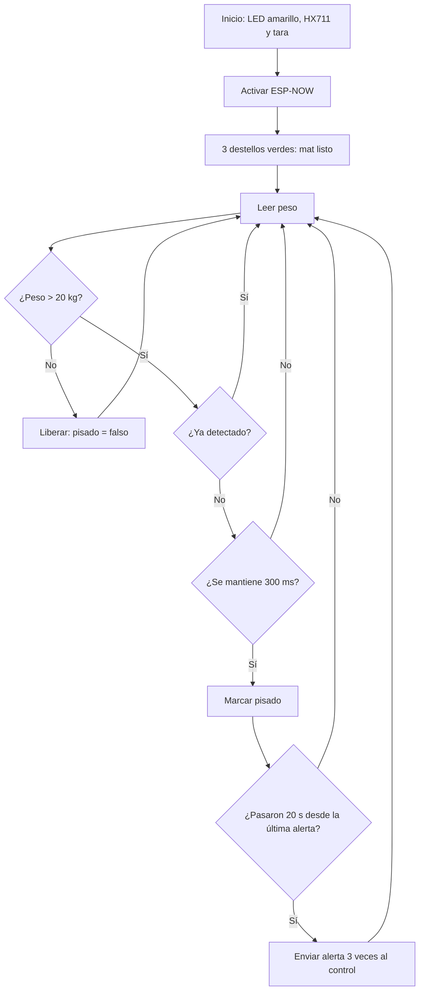
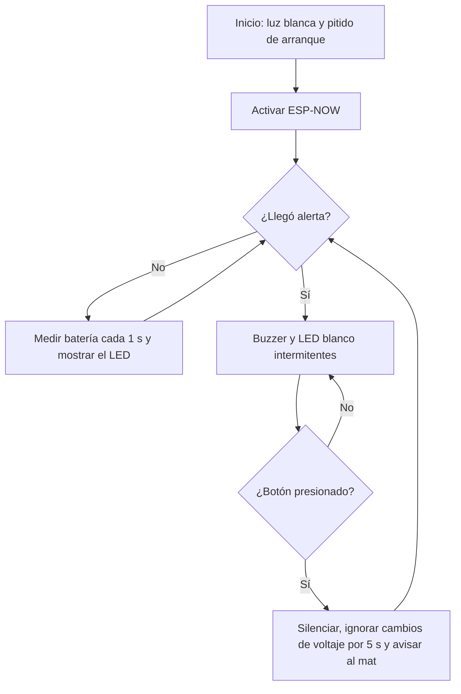
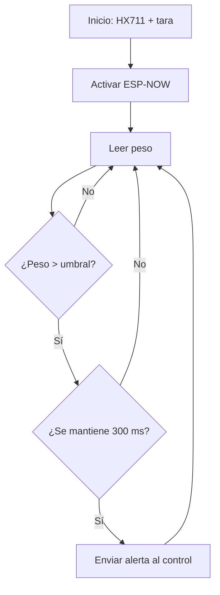
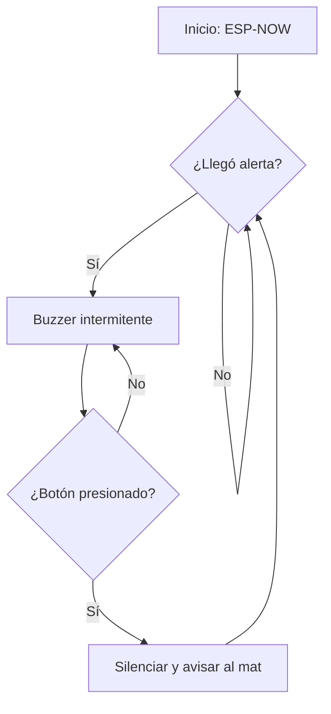

# Documentación de Software

Documentación del código del mat y del control. Contiene la **versión final (iteración 2)** y, más abajo, la **versión anterior (iteración 1)**, conservada como referencia.

> Las rutas de esta documentación parten desde la carpeta `software/`. El código de la versión final está en `software/src/` y el de la versión anterior en `software/src/Entrega anterior/`.

---

# Versión final (iteración 2)

## Contenido

### Diagramas de Flujo

**Mat (detección y envío de alerta):**

**Control (alarma, botón y batería):**

### Documentación de Funciones

#### Funciones Principales (mat)

**setup()**
- **Propósito:** enciende el LED en amarillo, inicia el HX711, toma la tara con el mat vacío, activa ESP-NOW y muestra 3 destellos verdes cuando está listo.
- **Parámetros:** ninguno.
- **Retorna:** nada.

**loop()**
- **Propósito:** lee el peso y aplica la lógica de la alerta: peso sobre el umbral durante 300 ms, una sola alerta por pisada y al menos 20 s entre alertas.
- **Parámetros:** ninguno.
- **Retorna:** nada.

**enviarAlerta()**
- **Propósito:** enviar la alerta al control por ESP-NOW (3 veces, para asegurar que llegue).
- **Parámetros:** ninguno.
- **Retorna:** nada.

**errorHX711()**
- **Propósito:** si el HX711 no responde (o falla ESP-NOW), avisa por el monitor serial y deja el LED rojo intermitente.
- **Parámetros:** ninguno.
- **Retorna:** nada (queda en un ciclo hasta reiniciar).

**colorLed(r, g, b)**
- **Propósito:** cambiar el color del LED WS2812.
- **Parámetros:** `uint8_t r`, `uint8_t g`, `uint8_t b`.
- **Retorna:** nada.

**alEnviar(mac, estado)**
- **Propósito:** informa si el mensaje llegó al control (`Entrega OK` o `Entrega FALLO`).
- **Parámetros:** `uint8_t *mac`, `uint8_t estado`.
- **Retorna:** nada.

**alRecibir(mac, datos, largo)**
- **Propósito:** se ejecuta al recibir un mensaje del control. Si es tipo 2, indica que el cuidador atendió la alarma.
- **Parámetros:** `uint8_t *mac` (origen), `uint8_t *datos` (mensaje), `uint8_t largo`.
- **Retorna:** nada.

#### Funciones Principales (control)

**alRecibir(mac, datos, largo)**
- **Propósito:** al recibir un mensaje tipo 1 (alerta), activa la alarma.
- **Parámetros:** `uint8_t *mac`, `uint8_t *datos`, `uint8_t largo`.
- **Retorna:** nada.

**colorLed(r, g, b)**
- **Propósito:** cambiar el color del LED WS2812.
- **Parámetros:** `uint8_t r`, `uint8_t g`, `uint8_t b`.
- **Retorna:** nada.

**leerBateria()**
- **Propósito:** leer el voltaje de la batería por A0 (promedio de 16 lecturas, con factor calibrado con multímetro).
- **Parámetros:** ninguno.
- **Retorna:** `float` con el voltaje en V.

**actualizarBateria()**
- **Propósito:** actualizar el estado de la batería (normal, baja, cargando o llena). Detecta que se enchufó el cargador cuando el voltaje sube de golpe y que se desenchufó cuando baja desde su máximo. Tras una alarma ignora los cambios por 5 s.
- **Parámetros:** ninguno.
- **Retorna:** nada.

**mostrarBateria()**
- **Propósito:** mostrar el estado de la batería con el LED: rojo (baja), naranjo (cargando), verde (llena) o apagado.
- **Parámetros:** ninguno.
- **Retorna:** nada.

### Parámetros principales del código

| Parámetro | Valor | Dónde |
|---|---|---|
| `UMBRAL_KG` | 20,0 | mat |
| `REPOSO_MS` | 20000 (20 s) | mat |
| `CONFIRMA_MS` | 300 | mat |
| `FACTOR_ESCALA` | 19260,0 | mat |
| `V_BAJA` | 3,55 V (~20 %) | control |
| `V_LLENA` | 4,10 V | control |
| `CANAL` | 1 | mat y control |

---

## Manual de Instalación

1. Instalar el Arduino IDE 2.x.
2. Instalar el core ESP8266 (v3.1.2) y las librerías HX711 (bogde, v0.7.5) y Adafruit NeoPixel (v1.15.5). Ver `software/librerias/README.md`.
3. Cargar `src/mac/mac.ino` en cada placa y anotar su dirección MAC.
4. Escribir la MAC del control en `macControl` (`src/mat_final/mat_final.ino`) y la del mat en `macMat` (`src/control_final/control_final.ino`).
5. Si cambian las celdas o el montaje del mat, volver a calibrar con `src/calibracion/calibracion.ino`: factor nuevo = factor anterior × (lectura / peso real). Escribir el resultado en `FACTOR_ESCALA`. El valor actual es 19260.
6. Cargar `src/mat_final/mat_final.ino` en el Wemos D1 R2 (mat) y `src/control_final/control_final.ino` en el Wemos D1 mini (control).

---

## Manual de Operación

### Encendido del Sistema
1. **Mat:** con el mat vacío y quieto, subir el interruptor KCD11. El LED se enciende en amarillo mientras toma la tara y luego hace 3 destellos verdes cuando está listo.
2. **Control:** subir el interruptor KCD11. Se enciende una luz blanca durante ~1,7 s y suena un pitido corto cuando está listo.

### Operación Normal
1. Cuando una persona de más de 20 kg pisa el mat durante 300 ms, el mat envía la alerta y el control suena de forma intermitente, con el LED blanco parpadeando.
2. El cuidador presiona el pulsador del control para silenciar la alarma.
3. El control avisa al mat que la alarma fue atendida.
4. El mat no repite la alerta mientras la persona siga sobre él. Para una nueva alerta debe bajar del mat, y deben pasar al menos 20 s desde la anterior.
5. Con una mascota de menos de 20 kg el mat no alerta.

### Indicadores del LED del control
| Color | Significado |
|---|---|
| Blanco intermitente | Alarma activa (junto con el buzzer) |
| Rojo fijo | Batería baja (~20 %) |
| Naranjo | Batería cargándose |
| Verde | Batería cargada (≥ 4,1 V) y cargador conectado |
| Apagado | Funcionamiento normal (ahorra batería) |

### Apagado del Sistema
1. Bajar el interruptor KCD11 del mat.
2. Bajar el interruptor KCD11 del control.

---

## Troubleshooting

### Problemas Comunes

**Problema 1: El LED del mat parpadea en rojo o el monitor dice "HX711 no responde"**
- Causa probable: mala conexión de VCC, GND, DT o SCK, o falla al iniciar ESP-NOW.
- Solución: revisar esos cuatro cables entre el HX711 y la placa y reiniciar el mat.

**Problema 2: El control no suena al pisar el mat, o el mat dice "Entrega FALLO"**
- Causa probable: las direcciones MAC no coinciden, las placas están en canales distintos, el control está apagado o fuera de alcance (por ejemplo, detrás de una pared de concreto).
- Solución: leer de nuevo la MAC con `mac.ino`, escribirla en el código contrario, verificar que ambos usen `CANAL = 1`, encender el control y acercarlo al mat.

**Problema 3: El peso sale negativo o con valores raros**
- Causa probable: cables blanco y negro de una celda al revés, topes mal ajustados o factor de calibración incorrecto.
- Solución: invertir los cables de la celda afectada, revisar la holgura de los topes y recalibrar `FACTOR_ESCALA` con un peso conocido.

**Problema 4: La alarma se activa con objetos o mascotas livianas**
- Causa probable: el umbral es muy bajo para ese peso.
- Solución: subir `UMBRAL_KG` en `mat_final.ino` según el peso real de una persona y de la mascota.

**Problema 5: La alarma no se activa con una persona liviana**
- Causa probable: su peso es menor que `UMBRAL_KG` (20 kg).
- Solución: bajar `UMBRAL_KG` en `mat_final.ino`, cuidando que una mascota no lo supere.

**Problema 6: El control recibe la alerta pero el buzzer no suena**
- Causa probable: el transistor 2N2222 está al revés o la resistencia está mal conectada.
- Solución: revisar la base (D5 por la resistencia de 1 kΩ), el colector (buzzer) y el emisor (GND).

**Problema 7: El LED del control sigue naranjo o verde después de desenchufar el cargador**
- Causa probable: el cargador se detecta por el voltaje de la batería, y con la batería casi llena el voltaje casi no cambia.
- Solución: es una limitación conocida (ver `iteraciones/iteracion_2/limitaciones_deteccion_alimentacion.md`); no afecta la alarma.

---
---

# Versión anterior (iteración 1)

Se conserva el texto de la entrega anterior como referencia. El código de esa versión está en `src/Entrega anterior/`.

## Contenido

### Diagramas de Flujo

**Mat (detección y envío de alerta):**

**Control (alarma y botón):**

### Documentación de Funciones

#### Funciones Principales (mat)

**enviarAlerta()**
- **Propósito:** enviar la alerta al control por ESP-NOW (3 veces, para asegurar que llegue).
- **Parámetros:** ninguno.
- **Retorna:** nada.

**esperarHX711()**
- **Propósito:** esperar a que el amplificador HX711 responda antes de continuar. Evita reinicios por un mal contacto.
- **Parámetros:** ninguno.
- **Retorna:** nada (muestra un aviso por el monitor serial si no responde).

**alRecibir(mac, datos, largo)**
- **Propósito:** se ejecuta al recibir un mensaje del control. Si es tipo 2, indica que el cuidador atendió la alarma.
- **Parámetros:** `uint8_t *mac` (origen), `uint8_t *datos` (mensaje), `uint8_t largo`.
- **Retorna:** nada.

**alEnviar(mac, estado)**
- **Propósito:** informa si el mensaje llegó al control (`Entrega OK` o `Entrega FALLO`).
- **Parámetros:** `uint8_t *mac`, `uint8_t estado`.
- **Retorna:** nada.

#### Funciones Principales (control)

**alRecibir(mac, datos, largo)**
- **Propósito:** al recibir un mensaje tipo 1 (alerta), activa la alarma.
- **Parámetros:** `uint8_t *mac`, `uint8_t *datos`, `uint8_t largo`.
- **Retorna:** nada.

---

## Manual de Instalación

1. Instalar el Arduino IDE 2.x.
2. Instalar el core ESP8266 (v3.1.2) y la librería HX711 (v0.7.5). Ver `software/librerias/README.md`.
3. Cargar `src/Entrega anterior/mac/mac.ino` en cada placa y anotar su dirección MAC.
4. Escribir la MAC del control en `macControl` (`src/Entrega anterior/mat/mat.ino`) y la del mat en `macMat` (`src/Entrega anterior/control/control.ino`).
5. Calibrar el mat con `src/Entrega anterior/calibracion/calibracion.ino` (ver "Calibración del Mat" en `software/README.md`) y escribir el resultado en `FACTOR_ESCALA`.
6. Cargar `src/Entrega anterior/mat/mat.ino` en el Wemos D1 (mat) y `src/Entrega anterior/control/control.ino` en el Wemos D1 Mini (control).

---

## Manual de Operación

### Encendido del Sistema
1. Con el mat vacío y quieto, conectar su alimentación y esperar el mensaje "Cero tomado".
2. Alimentar el control. Emite un pitido corto cuando está listo.

### Operación Normal
1. Cuando alguien pisa el mat, el control suena de forma intermitente.
2. El cuidador presiona el botón del control para silenciar la alarma.
3. El control avisa al mat que la alarma fue atendida para que deje de emitir alertas.

### Apagado del Sistema
1. Desconectar la alimentación del mat.
2. Apagar el control desconectando el cable de 5 V del módulo UPS (el interruptor del UPS solo corta la salida USB-A; si el cable queda conectado, la batería se descarga).

---

## Troubleshooting

### Problemas Comunes

**Problema 1: El mat muestra "HX711 no responde"**
- Causa probable: mala conexión de VCC, GND, DT o SCK.
- Solución: revisar esos cuatro cables entre el HX711 y la placa.

**Problema 2: El control no suena al pisar el mat**
- Causa probable: las direcciones MAC no coinciden, o las placas están en canales distintos.
- Solución: leer de nuevo la MAC con `mac.ino`, escribirla en el código contrario y verificar que ambos usen `CANAL = 1`.

**Problema 3: El mat se reinicia al arrancar**
- Causa probable: tomar el cero con ESP-NOW ya activo.
- Solución: usar el código actual, que toma la tara antes de iniciar ESP-NOW.

**Problema 4: La alarma se activa con objetos livianos**
- Causa probable: el umbral es muy bajo.
- Solución: subir `UMBRAL_KG` en `mat.ino` según el peso real de una persona.

**Problema 5: El control recibe la alerta pero el buzzer no suena**
- Causa probable: el transistor 2N2222 está al revés o la resistencia está mal conectada.
- Solución: revisar la base (D5 por la resistencia de 1 kΩ), el colector (buzzer) y el emisor (GND).